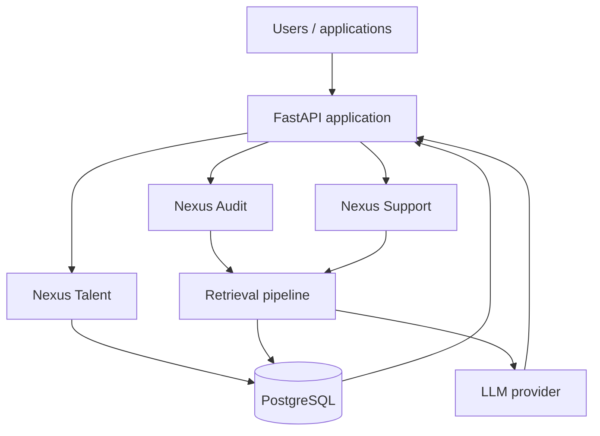

# Nexus Enterprise AI

**An AI platform for recruitment, financial document auditing, and customer support.**

Nexus combines large language models, retrieval-augmented generation (RAG) and a PostgreSQL database into three business tools that share one backend.

> **Status: in development.** The backend and API are working. A web interface is planned. This is a portfolio project that shows the architecture, not a production system for a real organization.

| Module | What it does |
|---|---|
| **Nexus Talent** | Recruitment support: structured candidate profiles and blind evaluation, with a recruiter making the final call |
| **Nexus Audit** | Financial document analysis: finds relevant evidence in documents and reports findings |
| **Nexus Support** | Customer support assistant that answers from approved business knowledge |

---

## 1. The problem

Companies keep important information scattered across resumes, financial documents, policies and product notes. Searching it and comparing it by hand is slow and inconsistent, and a general chatbot knows nothing about a company's own data.

## 2. The approach

Instead of a standalone chatbot, Nexus connects a business workflow to the company's own data before the AI answers:

**Business workflow → API → data and retrieval → LLM → structured result**

The three modules share the same foundation, so a new use case does not need a new system.

---

## 3. Modules

### Nexus Talent

`Candidate input → Document processing → Information extraction → Structured evaluation → Recruiter review`

- Turns resumes into structured candidate profiles
- Blind-evaluation workflow with consistent criteria
- Keeps a human in the loop: it assists recruiters and does not make hiring decisions

### Nexus Audit

`Financial documents → Ingestion → Retrieval → AI analysis → Audit findings`

- Ingests financial documents and retrieves the relevant passages
- Analysis is based on the retrieved source material, which reduces unsupported answers
- Structured outputs for evidence-based review

### Nexus Support

`Customer question → Knowledge retrieval → LLM response → Source-based answer`

- Answers customer questions from approved business knowledge
- Responses are grounded in retrieved documents, not general model knowledge alone

---

## 4. Architecture



| Layer | Technology | Responsibility |
|---|---|---|
| API | FastAPI | REST API and workflow control |
| Database | PostgreSQL | Application and business data |
| AI | LLM provider | Reasoning and text generation |
| Retrieval | RAG pipeline | Finds relevant context before the LLM answers |
| Deployment | Docker Compose | Reproducible local setup |

**Request flow:** a request reaches the FastAPI backend → it is routed to the right module → the module fetches data and documents → the retrieval pipeline passes the relevant context to the LLM → the backend returns a structured result.

---

## 5. Run it locally

You need **Docker**, **Docker Compose v2** and **Git**. Python and PostgreSQL do not need to be installed.

```bash
git clone https://github.com/Gallaxz-lab/nexus-enterprise-ai.git
cd nexus-enterprise-ai
cp .env.example .env
```

Open `.env` and fill in the values listed in `.env.example` (database connection, LLM API key, model name). Never commit your real `.env`.

```bash
docker compose up --build
```

Then open **http://localhost:8000/docs** to try the API. (If the port differs, check `docker-compose.yml`.)

Useful commands:

```bash
docker compose ps            # list running containers
docker compose logs -f       # follow logs
docker compose down          # stop
docker compose down -v       # stop and delete local database data
```

A demo script, `run_portfolio_demo.py`, and a helper for creating a test PDF, `create_test_pdf.py`, are included. This repository uses synthetic demo data only.

---

## 6. Current state and roadmap

**Working now**

- Modular AI workflows on a FastAPI backend
- PostgreSQL storage with migrations (Alembic)
- LLM integration and retrieval-based answers
- Docker-based local setup
- API-first access with interactive documentation

**Planned**

- Web interface (the main next step)
- Login and role-based access
- Per-document permissions
- Audit logging and monitoring
- Automated evaluation of answer quality
- Better retrieval (reranking, hybrid search)
- Background processing for large document sets
- Rate limiting and further API hardening
- CI/CD and cloud deployment
- Cost and token tracking

**Scope note:** Nexus is a reference implementation. It should not be treated as production-ready until security, privacy, reliability and compliance controls are built and tested.
